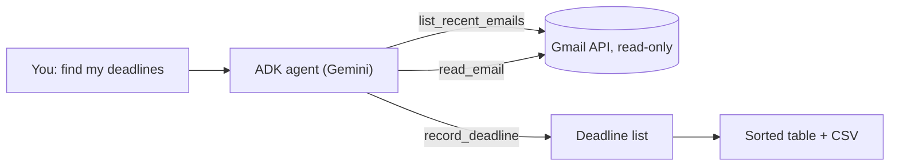

# 📬 Deadline Finder: an AI agent that finds deadlines in your Gmail

An AI agent built with **Google's Agent Development Kit (ADK)** and **Gemini**. It reads your recent Gmail (read-only), decides which emails might hold a deadline, opens them, and gives you one sorted table of everything that's due.

Deadlines get buried in long threads, reminders and newsletters. This agent pulls them out into a single list, with a link back to each original email so you can check it.


---

## What it does

- Looks through the last 30 days of your Gmail (you can change this), skipping the Promotions and Social tabs
- Lets the agent **choose** which emails to open, based on sender, subject and preview
- Saves every deadline it finds, with the **date, time, category, sender, and the exact phrase** from the email
- Saves repeated reminders for the same deadline only once
- Shows a colour-coded table (⚠️ passed · 🔴 today · 🟠 next 3 days · 🟡 this week · 🟢 later) and saves it as a CSV file
- Lets you ask follow-up questions, like *"Which three should I tackle first?"*

### Example output

*Sample data for illustration, not real emails.*

| Status | Due date | Task | Category | From |
|---|---|---|---|---|
| 🔴 Today | Sun 15 Nov 2026 | Submit course assignment | assignment | Course Office |
| 🟠 Next 3 days | Tue 17 Nov 2026 | Pay electricity bill | payment | Power Company |
| 🟡 This week | Fri 20 Nov 2026 | Register for industry conference | registration | Events Team |
| 🟢 Later | Tue 1 Dec 2026 | Renew library membership | renewal | City Library |

---

## How it works



The agent has three **tools**: plain Python functions that Gemini can choose to call.

| Tool | What it does |
|---|---|
| `list_recent_emails` | Returns the sender, subject, date and a short preview of recent emails |
| `read_email` | Opens one email and returns its full text |
| `record_deadline` | Saves one deadline, checking the date format and skipping repeats |

The agent works in a loop. It lists your emails, picks the ones that look relevant, reads them, saves the deadlines, and then writes a short summary.

### Design choices

- **The agent decides what to read.** It sorts emails by their preview first and only opens the likely ones. This is faster and cheaper than sending every email to the model.
- **Every deadline comes with evidence.** Each one includes the exact phrase from the email and a Gmail link, so you can check it in seconds.
- **Tools never crash the agent.** Each tool returns a `status`. When something fails, the agent gets a clear error message it can act on.
- **Protected against prompt injection.** The instructions tell the agent that email text is information, never orders. A message saying "AI, ignore your instructions…" is just read, not obeyed.
- **Read-only access.** It uses the `gmail.readonly` scope, so the agent cannot send, delete or change emails.
- **Handles busy servers.** It retries automatically when Gemini returns a rate limit (429) or a "server busy" error (500/503).

---

## Tech stack

- [Google Agent Development Kit (ADK)](https://adk.dev/), Python, version 2.x
- Gemini API (default model: `gemini-flash-latest`)
- Gmail API with OAuth 2.0 (`gmail.readonly` scope)
- pandas and Jupyter

---

## Getting started

### Prerequisites

- Python 3.10 or newer, and Jupyter (Anaconda works well)
- A Google account with Gmail
- A Gemini API key (see step 3)

### 1. Get the code

```bash
git clone https://github.com/<your-username>/deadline-finder-agent.git
cd deadline-finder-agent
pip install -r requirements.txt
```

### 2. Set up Gmail access (one-time, about 15 minutes)

1. In the [Google Cloud Console](https://console.cloud.google.com), create a project and **enable the Gmail API**.
2. Go to **Google Auth platform → Branding → Get started**. Give the app a name, choose **External** as the audience, and add your contact email.
3. Go to **Audience → Test users** and **add your own Gmail address**. If you skip this, Google will block the sign-in.
4. Go to **Clients → Create client → Desktop app**, then click **Download JSON**.
5. Rename the file to `credentials.json` and put it next to the notebook. **Never commit this file.**

### 3. Get a Gemini API key

Create your key in [Google AI Studio](https://aistudio.google.com/app/apikey). Keys made there are locked to the Gemini API by default. Since June 2026, the Gemini API rejects keys that aren't locked to it.

- **Free tier:** use a project with **no billing account** attached. You'll have rate limits, and Google may use what you send to improve its products.
- **Paid tier:** use a project with billing and prepaid credits. You get higher limits, and your data isn't used to improve Google's products.

The notebook asks for the key each time you run it. It is never saved in the file.

### 4. Run it

Open `deadline_finder_agent.ipynb` and run the steps in order. The first time, a browser tab opens and asks you to sign in to Gmail. If you see "Google hasn't verified this app", click **Continue**, because it's your own app.

---

## Settings

Change these in **Step 2** of the notebook:

| Setting | Default | What it controls |
|---|---|---|
| `DAYS_BACK` | `30` | How many days of email to search |
| `MAX_EMAILS` | `100` | The most emails the agent will see (use 50 on the free tier) |
| `SKIP_FILTER` | `-category:promotions -category:social` | Gmail search words for emails to skip |
| `MAX_BODY_CHARS` | `6000` | Very long emails are cut to this length |
| `MODEL` | `gemini-flash-latest` | The Gemini model. Try a Flash-Lite model if Flash is busy |

---

## Privacy and security

- **Read-only.** The Gmail permission can only read. It cannot send, delete or change anything.
- **Runs on your computer.** Your emails are read on your machine. Only the email text the agent needs is sent to the Gemini API.
- **Secrets stay local.** `credentials.json`, `token.json` and `my_deadlines.csv` are listed in `.gitignore`, so git ignores them.
- **Clear outputs before you commit.** Notebook outputs can contain email subjects, senders and addresses. Use **Edit → Clear All Outputs** in Jupyter before you commit.

---

## Troubleshooting

| Error | What it means | Fix |
|---|---|---|
| `403 PERMISSION_DENIED` · `API_KEY_SERVICE_BLOCKED` | The key isn't locked to the Gemini API | Make a new key in AI Studio, or lock the old one to the Gemini API in Cloud Console → Credentials |
| `402` · "prepayment credits are depleted" | The key's project has billing attached but no credits left | Add credits, or make a key in a new project without billing (free tier) |
| `503 UNAVAILABLE` · "high demand" | Google's servers are busy | Wait a few minutes and run again, raise `attempts` in Step 6, or switch `MODEL` to a Flash-Lite model |
| `429 RESOURCE_EXHAUSTED` | You hit the rate limit | Wait a minute, or lower `MAX_EMAILS` |
| "Access blocked: … has not completed the Google verification process" | You aren't listed as a test user | Add your Gmail address under Audience → Test users |
| `invalid_grant` / "Token has been expired or revoked" | Sign-ins expire after about 7 days while the app is in Testing mode | Delete `token.json` and run Step 3 again |
| The sign-in tab never opens | The OAuth sign-in needs a local browser | Run Jupyter on your own computer, not in Google Colab |

---

## Limitations

- The agent can misread a date, so always check important deadlines with the link in the table.
- It reads email text only. Deadlines inside attachments, such as PDFs, are missed.
- It only sees emails within the `DAYS_BACK` and `MAX_EMAILS` limits.
- The Gmail links open in the first Google account you're signed into (`u/0`).

## Ideas for what's next

- [ ] Add each deadline to **Google Calendar**
- [ ] Run it on a **daily schedule** and email myself the table
- [ ] Read **PDF attachments**
- [ ] Build a small **test set** of labelled emails to measure how many deadlines it finds and how many it gets wrong

---

## Project structure

```
deadline-finder-agent/
├── deadline_finder_agent.ipynb   # the agent, built step by step
├── requirements.txt              # Python packages
├── .gitignore                    # keeps secrets and personal results out of git
└── README.md
```

## License

MIT. See [LICENSE](LICENSE).

## Author

Built by **Soumya Subhra Bhowmik**.
